# NETWORKWALKS-B084-WK2-PM1-5-CYBERSECURITY
# Penetration Testing Report

**Footprinting & Network Scanning Phases**

W2-PM-FINAL | Cybersecurity | NetworkWalks

| | |
|---|---|
| **Pentester Name** | Omar Moamen |
| **Program / Batch** | B084M - NetworkWalks Cybersecurity Internship |
| **Date** | 13 November 2026 |
| **Modules completed** | W2-PM1 (Multiple Kali Tools) W2-PM2 (GHDB) W2-PM3 (Maltego) W2-PM4 (theHarvester) W2-PM5 (Zenmap Scanning) |
| **Client / Target** | 1. `networkwalks.com` (PM1) 2. Publicly accessible pages returned by search engines (PM2) 3. `microsoft.com` (PM4) 4. My own home LAN (PM5) |
| **Permission secured from client?** | PM5 covered my own LAN. PM1–PM4 are documented as footprinting/research exercises; this report does not claim written authorization from the owners of third-party websites. |
| **Phases covered** | **Phase 1:** Reconnaissance & Footprinting **Phase 2:** Scanning & Network Discovery **Phase 3-5:** In progress |

---

## 1. Liability Disclaimer

I have performed these activities only on the systems and devices where I had secured written permission or the devices/systems that I own myself. All these materials are for education and research purposes only. Do not use anything from here to break the law. The instructor, the authors and NetworkWalks are not responsible for what you do with this knowledge. Every action you take is your own responsibility. Misuse can lead to criminal charges, heavy fines, loss of your job and a permanent record. In most countries unauthorised access is a crime even when nothing is damaged.

## 2. Introduction

This is my Week 2 report for the NetworkWalks Cybersecurity internship. This week was about the first two phases of a penetration test: footprinting (collecting public information about a target) and scanning (finding what is alive on a network).

The week covered five modules: six Kali tools against `networkwalks.com` (PM1), Google dorking using the Google Hacking Database (GHDB) (PM2), an attempted Maltego exercise (PM3), theHarvester output collection (PM4), and a Zenmap ping scan of my own home LAN (PM5). Footprinting activities were carried out using Kali Linux; Zenmap was used on Windows.

The PM2 work used search-engine results and publicly accessible pages. Some GHDB-related results were blocked by my ISP, so I used accessible public examples instead. I did not attempt to bypass the ISP restriction, log in to any camera, or test credentials. For PM3, I attempted to obtain Maltego but the download website was unavailable, preventing completion of the hands-on portion. PM4 is documented by retaining the tool outputs. PM5 was limited to host discovery on my own LAN.

**Scope and authorization:** The Zenmap scan was performed on my own home network. The other modules involved passive collection or review of publicly accessible information and tool-output exercises. This report does not imply that I had authorization to test or access the underlying systems belonging to third parties. No exploitation, credential attempts, or intrusive testing is claimed.

## 3. Tools Used

| Tool | Purpose | Version |
|---|---|---|
| Kali Linux / Windows | Operating systems used for the activities | Updated to latest available versions at the time of the exercise |
| WHOIS | Domain registration details (owner, dates, name servers) | Latest available version at the time of the exercise |
| whatweb | Fingerprint web technologies (server, CMS, plugins) | Latest available version at the time of the exercise |
| nslookup | Resolve the domain name to its IP address | Latest available version at the time of the exercise |
| curl | Read HTTP response headers | Latest available version at the time of the exercise |
| wafw00f | Detect whether a Web Application Firewall is present | 2.4.2 |
| dnsrecon | Enumerate DNS records (NS, MX, SPF, TXT, SRV) | Latest available version at the time of the exercise |
| Google + GHDB (Exploit-DB) | Find publicly indexed devices, pages and files with search dorks | n/a |
| Maltego | Graph-based link analysis; installation/download was attempted but could not be completed | Not installed; download site unavailable |
| theHarvester | Collect emails, sub-domains and hosts from public sources | 4.10.1 (confirmed in attached Baidu output) |
| Zenmap (Nmap GUI) | Ping scan of my LAN to find live hosts, IPs and MACs | Latest available version at the time of the exercise |
| Windows CMD (`ipconfig`) | Local IP, subnet and MAC address | n/a |

## 4. Activities Performed

### 4.1 Footprinting with multiple Kali tools (W2-PM1)

Target: `networkwalks.com`. I ran six tools, each one showing a different side of the same target.

All six were run from Kali on 13 November 2026.

**whois networkwalks.com.** The domain was registered on 6 November 2019 through GoDaddy and is paid up to 6 November 2027 (last updated 12 November 2025). The owner's details are hidden behind a privacy service (Domains By Proxy, Arizona), so there is no personal name, phone or email to pick up, only a GoDaddy contact form. The name servers are `NS6135.HOSTGATOR.COM` and `NS6136.HOSTGATOR.COM`, so the site is hosted on HostGator. The registrar's own record also lists two GoDaddy name servers (`NS29/NS30.DOMAINCONTROL.COM`). DNSSEC is unsigned.

**whatweb networkwalks.com.** The site runs on Apache and WordPress 7.1.4 with the WordPress Download Manager plugin 3.3.76, both read straight from the page's generator tag. It also showed jQuery 3.7.1, Google Tag Manager, the server IP `192.232.216.135` (United States), a `__wpdm_client` cookie and the contact email `info@networkwalks.com`. Two things I want to be upfront about:

- WhatWeb reported "Bootstrap 7.1.4", which is the same number as WordPress, so that is the tool guessing wrong. I did not count it as a finding.
- The plain `http://` request was redirected to a `megaplusredirection.tedata.net` page, which is my ISP's redirection page (a middlebox in the path), not networkwalks.com. WhatWeb then fingerprinted that page too (IIS 8.5, ASP.NET). That third result describes my ISP's page, so I left it out of the findings.

**nslookup networkwalks.com.** Using Google's resolver `8.8.8.8` it returned a single address, `192.232.216.135`, the same IP WhatWeb reported.

**curl -I https://networkwalks.com.** The site answers `200 OK` with `Server: Apache` and no version number. The `Link` header points to the WordPress REST API (`/wp-json/`, and `/wp-json/wp/v2/pages/53`). It sets the `__wpdm_client` cookie with the `Secure` and `HttpOnly` flags. Two non-standard headers, `X-Endurance-Cache-Level` and `X-nginx-cache: WordPress`, point to a caching layer in front of Apache and to the hosting provider's setup. I did not see `Strict-Transport-Security`, `X-Frame-Options`, `Content-Security-Policy` or `X-Content-Type-Options` in the response.

**wafw00f networkwalks.com.** wafw00f v2.4.2 detected **ModSecurity (SpiderLabs)** after 2 requests, so the site is behind a WAF.

**dnsrecon -d networkwalks.com.** It found 8 records:

- SOA and NS records pointing at the two HostGator name servers (`50.87.144.87` and `192.232.216.131`). Both reported the DNS software version `9.16.23-RH` (BIND).
- An A record and an MX record (`mail.networkwalks.com`) that both resolve to `192.232.216.135`, so web and mail are on the same IP.
- An SPF record: `v=spf1 +a +mx +ip4:50.87.144.87 +include:websitewelcome.com ~all`.
- A `google-site-verification` TXT record.
- Eight `_autodiscover._tcp` SRV records pointing to `cpanelemaildiscovery.cpanel.net` on port 443, which shows the hosting uses cPanel.
- A "no answer for DNSSEC query" error, which matches whois saying DNSSEC is unsigned.

**Putting it together.** From public information alone I ended up with the hosting provider, the registrar, the real server IP, the CMS and plugin versions, the mail setup and the fact that a WAF is watching. None of it needed anything more than ordinary queries. Version numbers and the WAF matter most, because an attacker would use them to pick the next step (look up WordPress and plugin issues, and adapt around ModSecurity). I did not test any of that, and a version number alone does not make the site vulnerable.

### 4.2 Footprinting with GHDB (W2-PM2)

The dorks came from GHDB on Exploit-DB (the last Rome one is a site-restricted variation of a webcam dork). I did not use Shodan or any other source for this module. All links were opened in a normal browser on 13 November 2026. I did not log in or try default credentials on anything, and none of these pages asked for a login.

**Task 1: exposed security cameras**

| No. | Link | Relevant dork | Username / Password (if any) |
|---|---|---|---|
| 1 | https://www.nps.gov/subjects/air/webcams.htm?site=grpk | `intitle:"Webcam" inurl:WebCam.htm` | --- |
| 2 | https://www.lmc.edu/webcam.htm | `intitle:"Webcam" inurl:WebCam.htm` | --- |
| 3 | https://www.towson.edu/campus/landmarks/webcam.html | `intitle:"Webcam" inurl:WebCam.htm` | --- |
| 4 | https://www.nihm.ca/webcam/ | `intitle:"Index of /webcam/"` | --- |
| 5 | https://ns.ph.liv.ac.uk/webcam/ | `intitle:"Index of /webcam/"` | --- |
| 6 | https://cdn.tierradelfuego.org.ar/webcam/ | `intitle:"Index of /webcam/"` | --- |
| 7 | https://boulderjct.org/webcam/ | `intitle:"Index of /webcam/"` | --- |
| 8 | https://www.skylinewebcams.com/en/webcam/italia/lazio/roma/pantheon.html | `inurl:webcam site:skylinewebcams.com inurl:roma` | --- |
| 9 | https://www.skylinewebcams.com/en/webcam/italia/lazio/roma/fontana-di-trevi.html | `inurl:webcam site:skylinewebcams.com inurl:roma` | --- |
| 10 | https://www.skylinewebcams.com/en/webcam/italia/lazio/roma/piazza-di-spagna.html | `inurl:webcam site:skylinewebcams.com inurl:roma` | --- |

**Task 2: downloadable mathematics PDF listings**

| No. | Link | Relevant dork | Username / Password (if any) |
|---|---|---|---|
| 1 | https://education.giakonda.org.uk/Maths/?SD | `intitle:index.of "parent directory" mathematics pdf` | --- |
| 2 | http://erewhon.superkuh.com/library/Math/ | `intitle:index.of "parent directory" mathematics pdf` | --- |
| 3 | https://netlib.org/math/docpdf/ | `intitle:index.of "parent directory" mathematics pdf` | --- |
| 4 | https://justmathbg.info/files/ | `intitle:index.of "parent directory" mathematics pdf` | --- |
| 5 | http://www.unm.edu/~megrad/Math/ | `intitle:index.of "parent directory" mathematics pdf` | --- |
| 6 | https://www.maths.dur.ac.uk/papers/2025/ | `intitle:index.of "parent directory" mathematics pdf` | --- |
| 7 | https://ochicken.net/library/Mathematics/ | `intitle:index.of "parent directory" mathematics pdf` | --- |
| 8 | https://case.edu/artsci/math/singer/publish/ | `intitle:index.of "parent directory" mathematics pdf` | --- |
| 9 | http://pcwww.liv.ac.uk/maths/ | `intitle:index.of "parent directory" mathematics pdf` | --- |
| 10 | https://www.math.cmu.edu/users/math/mlavrov/arml/16-17/ | `intitle:index.of "parent directory" mathematics pdf` | --- |

The listed URLs are public pages selected as accessible examples for the exercise. My ISP automatically blocks access to some GHDB results, so I did not attempt to circumvent those restrictions; I used publicly accessible alternatives instead. The two Rome webcam pages are public tourism webcams, and the Durham URL is a mathematics papers directory. A search result or publicly viewable page is not, by itself, evidence of a security vulnerability or permission to access private camera controls or restricted files.

### 4.3 Footprinting with Maltego (W2-PM3)

I attempted to complete the Maltego portion of the exercise, but the Maltego website was unavailable when I tried to access it to download the tool. As a result, I could not install the application or carry out the planned graph-based footprinting exercise.

This is recorded as an attempted but blocked activity, rather than as a completed Maltego investigation. No entities, transforms, or findings are claimed.

### 4.4 Footprinting with theHarvester (W2-PM4)

The task evidence for this module is the saved theHarvester output. The attached Baidu run identifies the tool as **theHarvester 4.10.1**, targets `microsoft.com`, and uses the Baidu source. The output reports:

- No IP addresses found.
- No email addresses found.
- No people found.
- No hosts found.

A zero-result run is still a valid record of what this source returned during the exercise; it does not establish that the target has no publicly discoverable information. The separate all-sources output is retained as task evidence when added to the repository. No additional findings are inferred from the Baidu run.

### 4.5 Network scanning with Zenmap (W2-PM5)

On Windows I ran `ipconfig` to find my IP address and LAN subnet: my PC is `192.168.100.83` on `192.168.100.0/24`. In Zenmap I entered that subnet and used the **Ping Scan** profile, which runs `nmap -sn 192.168.100.0/24`.

Nmap finished with: *256 IP addresses (9 hosts up) scanned in 31.12 seconds*.

- **Live hosts:** 9, including my own PC.
- **IP and MAC addresses:**

| IP | MAC | Vendor (as reported) | Notes |
|---|---|---|---|
| 192.168.100.1 (`dev.opt`) | see portal submission | | The gateway/router, shown with a hostname |
| 192.168.100.2 | C6:D3:69:A7:6C:F0 | Unknown | |
| 192.168.100.3 | D6:C1:19:3D:17:56 | Unknown | |
| 192.168.100.5 | D6:A2:59:76:4B:11 | Unknown | |
| 192.168.100.9 | D4:F3:2D:CF:62:1E | Intel Corporate | |
| 192.168.100.33 | CA:78:45:65:C5:CD | Unknown | |
| 192.168.100.95 | F0:68:E3:B0:57:A6 | AzureWave Technology | |
| 192.168.100.116 | 1C:CC:D6:C0:34:81 | Xiaomi Communications | |
| 192.168.100.83 | see portal submission | n/a | My own PC. Nmap does not list a MAC for the machine it runs on, so it comes from `ipconfig /all` |

Four of the hosts came back with vendor "Unknown" (`.2`, `.3`, `.5` and `.33`). Their MAC addresses start with `C6`, `D6`, `D6` and `CA`, which are the kind of locally administered (randomised) addresses that phones and tablets use when private Wi-Fi addresses are turned on, so Nmap has no vendor to match them to. That is my reading and not something Nmap confirmed.
I then opened the Topology tab, turned on the legend and saved the graphic as a PDF: [`topology/topology.pdf`](topology/topology.pdf). The topology shows my PC as `localhost` in the centre and all other hosts around it with dashed lines, which the legend defines as "no traceroute information". That is expected for a ping scan of my own subnet, where everything is one hop away and no port or traceroute scan was run. The full details (command output, IP list and MAC list) were also submitted through the internship portal form.

## 5. Risk Analysis / Impact

| # | Risk / Finding | Evidence / Observation | Potential Impact | Risk Level |
|---|---|---|---|---|
| 1 | CMS and plugin versions exposed | WhatWeb read WordPress 7.1.4 and WordPress Download Manager 3.3.76 from the page's generator tag | Attackers can look these versions up against known issues and aim at WordPress and plugin weaknesses | Medium |
| 2 | Server IP and hosting provider identifiable | `192.232.216.135` from nslookup and WhatWeb, HostGator name servers from whois | Shows exactly where the service lives and who hosts it | Low |
| 3 | WordPress API and technical headers exposed | `curl -I` showed `/wp-json/` in the `Link` header and cache headers (`X-Endurance-Cache-Level`, `X-nginx-cache`) | Helps fingerprint the stack and find extra endpoints to enumerate | Low |
| 4 | Security headers not seen in the response | No `Strict-Transport-Security`, `X-Frame-Options`, `Content-Security-Policy` or `X-Content-Type-Options` in the `curl -I` output | Weaker browser-side protection against things like clickjacking | Low |
| 5 | WAF identifiable | wafw00f detected ModSecurity (SpiderLabs) | Tells an attacker a WAF is present so they can plan around it | Low |
| 6 | DNS software version and records exposed | dnsrecon returned BIND `9.16.23-RH` on both name servers, the mail server, SPF, TXT and cPanel SRV records | Builds a picture of the infrastructure. The `-RH` suffix suggests a Red Hat build, which often back-ports fixes, so the version alone says little | Low |
| 7 | SPF policy is a soft fail | SPF record ends in `~all` and includes `+a +mx` | Spoofed mail from the domain is more likely to get through than with a strict `-all` | Low |
| 8 | DNSSEC not enabled | whois says unsigned and dnsrecon found no DNSSEC answer | DNS answers cannot be cryptographically verified | Low |
| 9 | Many live hosts visible on the local network | Zenmap found 9 live hosts in `192.168.100.0/24`, four with an unknown vendor (likely randomised MAC addresses) | Without an inventory, an unknown or unauthorised device would be hard to spot | Low |
| 10 | Publicly indexed webcam pages and mathematics papers directory identified through GHDB searches | Public URLs were accessible without authentication; ISP-blocked results were not bypassed | Public information may reveal operational details or files intended for public distribution; exposure should be reviewed by the site owner, but no vulnerability was confirmed | Informational / Low |
| 11 | Maltego exercise could not be completed | Maltego download website was unavailable during the attempt | No technical impact finding can be drawn because no analysis was performed | N/A |
| 12 | theHarvester Baidu run returned no results | theHarvester 4.10.1 output for `microsoft.com` reported zero IPs, emails, people and hosts | No finding can be established from this source's empty result; other sources may return different data | N/A |

These are observations from information gathering and host discovery, not confirmed vulnerabilities. No exploitation was performed, so seeing a version number, IP or DNS record does not by itself mean the system is vulnerable.

## 6. Recommendations

The following are general defensive recommendations based on the observations above. They are not claims that a vulnerability was confirmed.

1. **Reduce unnecessary technology disclosure:** Keep WordPress, plugins and server components updated, and avoid exposing version information where it is not operationally required.
2. **Review HTTP security headers:** The observed response did not include several commonly used browser security headers. The site administrator should assess whether HSTS, CSP, `X-Frame-Options` (or an appropriate CSP `frame-ancestors` directive), and `X-Content-Type-Options` are suitable for the application.
3. **Review DNS configuration:** The domain owner should periodically review DNS records, mail configuration, DNSSEC availability and SPF policy. Any SPF policy change should be tested against legitimate sending services before deployment.
4. **Inventory local network devices:** Maintain an inventory of expected devices and investigate unfamiliar hosts. Randomized MAC addresses can make vendor identification unreliable, so device identity should be checked through the router or the device itself.
5. **Review public directories and camera pages:** Site owners should confirm that each publicly indexed directory and webcam page is intentionally public and contains no private or sensitive material.
6. **Treat passive reconnaissance as a starting point:** Tool output and search results should be verified by the system owner. A detected version, public page or empty search result does not independently prove a vulnerability or prove the absence of one.

## 7. Conclusion

This week's activities showed how much information can be collected before any active testing takes place. The Kali tools provided different views of the same domain, including registration data, DNS records, web technologies, response headers and WAF identification. GHDB searches demonstrated how ordinary search engines can locate publicly accessible pages and directories, while theHarvester showed that results depend on the selected data source. The Maltego exercise could not be completed because its download site was unavailable. Finally, Zenmap provided a view of the live devices on my own home network.

An important lesson was to distinguish an observation from a confirmed vulnerability. Publicly visible information can help build an infrastructure picture, but it needs context and verification. All work described here was limited to passive public-information review or my own LAN; no exploitation or credential attempts were performed.

## 8. Evidences Collected

### W2-PM1

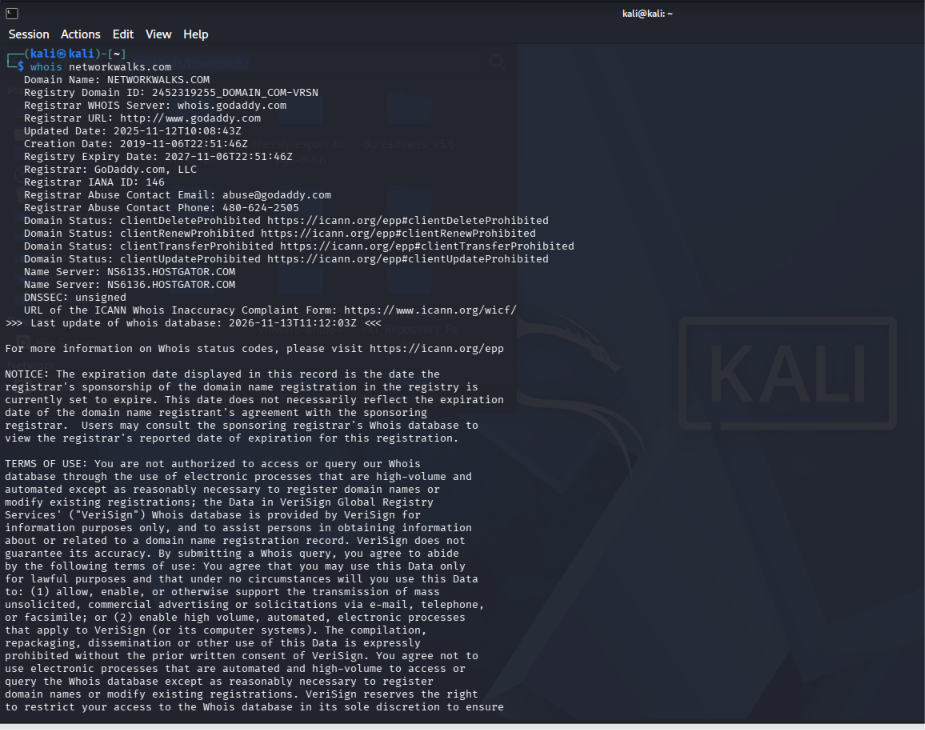

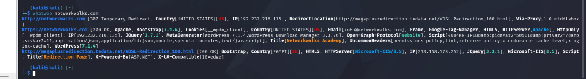

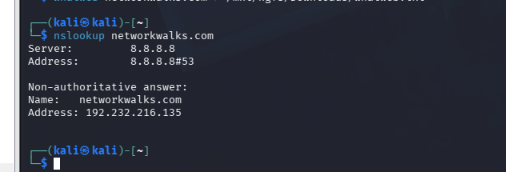

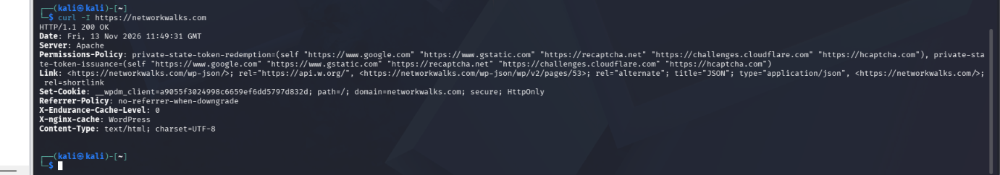

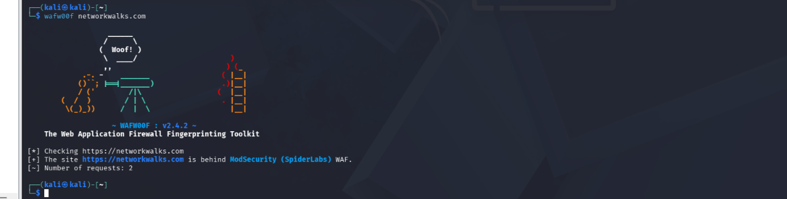

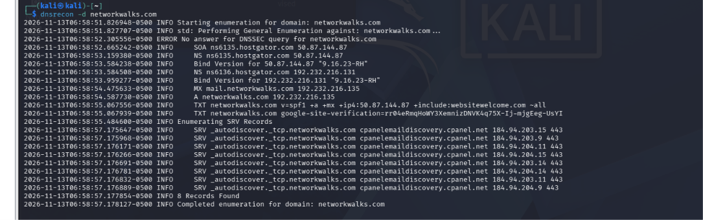

### W2-PM5

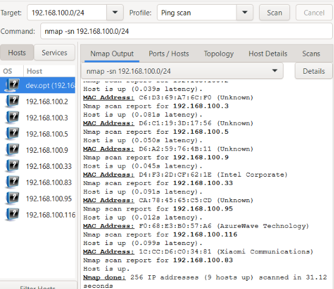

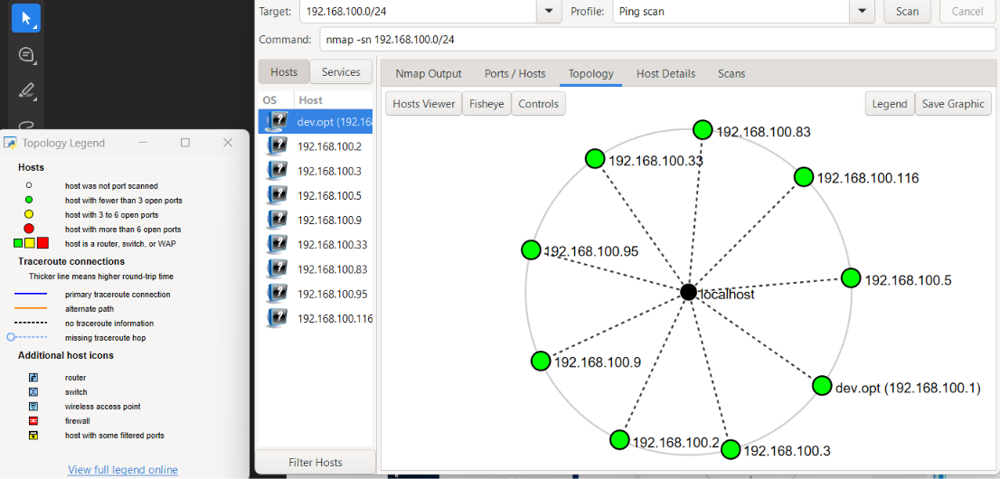

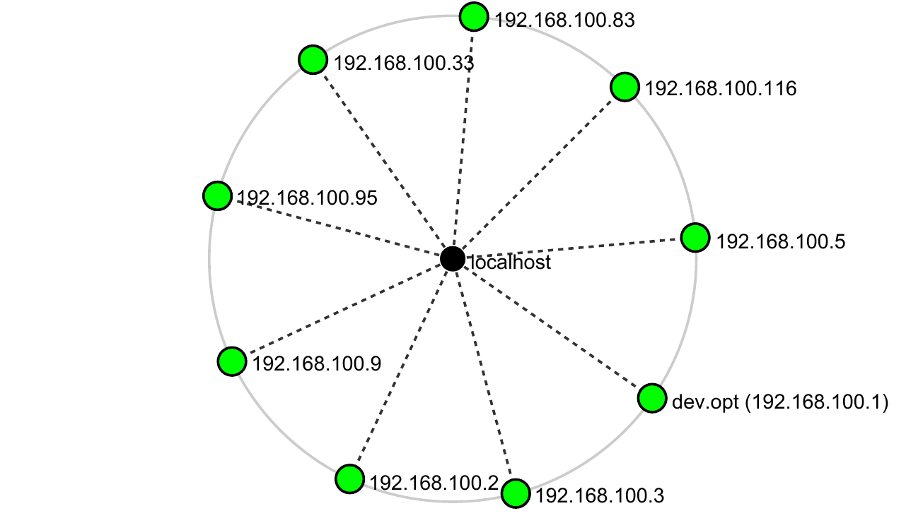

### W2-PM2

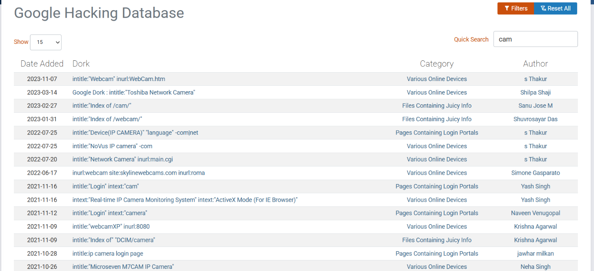

### W2-PM4

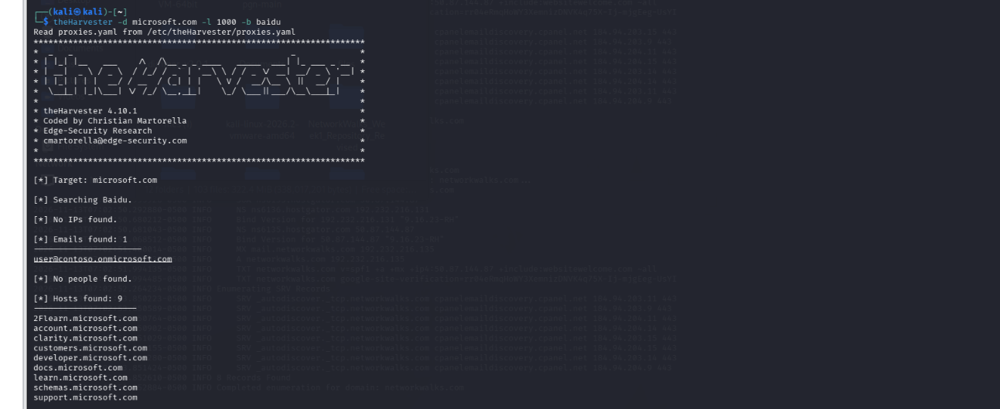

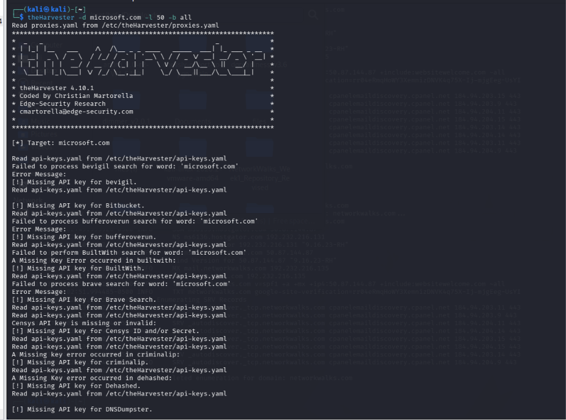

Raw tool output is in [`outputs/`](outputs/), and the topology PDF is in [`topology/`](topology/).
